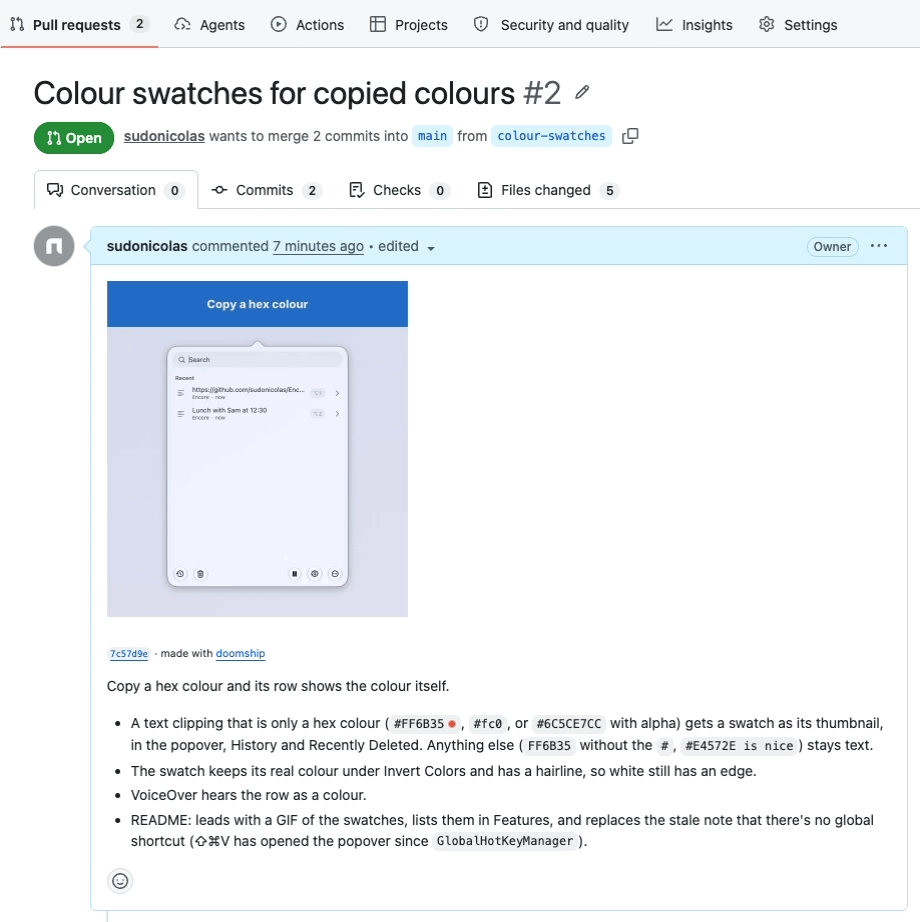
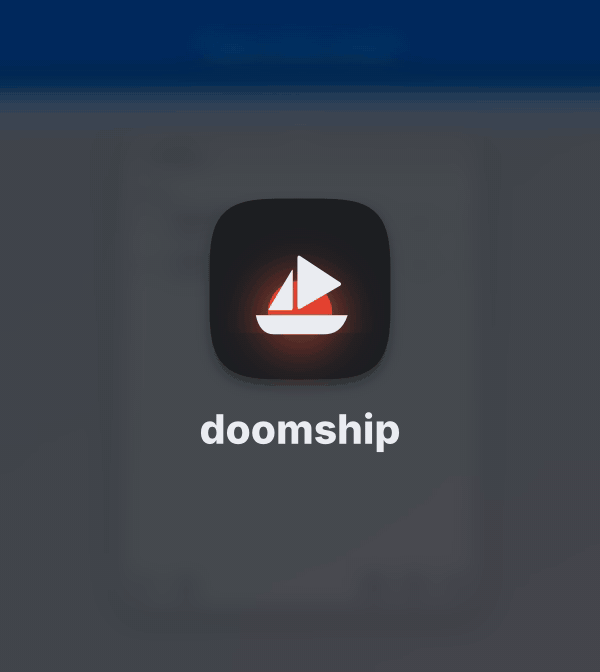

<p align="center">
  
</p>

<h1 align="center">doomship</h1>

<p align="center">
  <b>A GIF of exactly what your pull request changes, right in the pull request.</b><br>
  Your coding agent writes the demo. doomship records it, captions it and posts it.
</p>

<p align="center">
  
</p>

<p align="center"><sub>
  <a href="https://github.com/sudonicolas/Encore/pull/2">A real pull request</a> to
  <a href="https://github.com/sudonicolas/Encore">Encore</a>, a menu bar clipboard history: the
  demo written by the agent, the rest by doomship. No edits by hand.
</sub></p>

---

Reviewers can't see a UI change in a diff. They check out the branch and run it, or they trust
the description. Coding agents make changes faster than anyone can do that.

doomship closes the gap. Point it at a commit, a branch, a range or your uncommitted working
tree. The agent reads the change, writes a short demo that drives your app with your platform's
own test tool, and doomship turns the recording into a looping GIF: captions, a ring wherever a
tap lands, and a zoom on the new thing. Then it goes into the PR description, where it plays as
soon as the reviewer opens the page.

## The GIF

<p align="center">
  
</p>

<p align="center"><sub>
  The GIF from that pull request, as doomship rendered it.
</sub></p>

The web driver plays the demo in a phone-sized browser (390 by 844 at 3x, with touch) or a
desktop one (1280 by 720 at 2x). On iOS it runs in the Simulator, and on the Mac inside the app
itself. Every GIF:

- **shows the change, in order**, from the screen nearest to it to the result;
- **captions each step** in a band above the screen, in your app's accent colour, so the app
  itself is never covered;
- **draws a ring** where each tap lands, and **zooms in** on a new or changed element;
- **skips the waiting**: idle stretches play at 4x;
- **loops**, and stays under GitHub's 10 MB image limit (usually 2 to 5 MB);
- **opens and closes on the doomship splash**, so a GIF seen anywhere says what made it.

A change with nothing to see (a data model, a refactor) is skipped with a one-line reason,
never padded with filler.

## On the Mac

A Swift package app is built with `swift build` and launched with a small library that plays the
demo from inside it. It finds buttons and rows through the accessibility API, as XCUITest does,
and captures only the app's own windows, over a plain backdrop: never your desktop, your menu bar
or another app. The app runs with an empty home folder and a clipboard of its own, so it can't
read your data, and nothing it does reaches your real clipboard.

## How it works

```
  your repo + a change
        │
  1 prepare  (CLI)    export that tree to a cache, diff it, gather context  ──▶  context.md
        │
  2 script   (agent)  read context.md; skip, or write the demo + captions  ──▶  demo.swift | demo.ts
        │
  3 record   (CLI)    build, launch, run the demo while recording           ──▶  video + events
        │                 └─ failed? the error and its line go back to step 2 (3 tries at most)
  4 render   (CLI)    cut, caption, rings, zooms, splash, palette           ──▶  .gif .png .json
        │
  5 post     (CLI)    host the GIF on GitHub and put it in the PR           ──▶  the PR description
```

The agent does the judgment: what the change is, how to reach it, what to call each step.
Everything else is deterministic. **Your repo is never written to**, its `.git` included: the
change is exported into `~/Library/Caches/doomship/`, built and served from there, and the GIFs
land in `~/Movies/doomship/`.

A demo uses your platform's own test tool, so your existing tests are the examples and the
compiler catches mistakes. On iOS it's an XCUITest, on the web a Playwright script, and on the
Mac Swift that runs inside the app:

```swift
// demo.swift, written by the agent for Encore 7c57d9e (abridged)
func play(_ demo: Demo) throws {
    try demo.clickMenuBarItem()                  // open the popover, before the GIF starts
    demo.begin()

    demo.caption("Copy a hex colour")
    demo.hold(0.8)
    demo.copy("#FF6B35")                         // the app's own clipboard, never yours
    let orange = try demo.element("#FF6B35")     // waits for the new row
    demo.caption("Encore shows it as a swatch")
    demo.show(orange, seconds: 2)                // zoom in, outlined

    demo.caption("Short hex and alpha work too")
    demo.copy("#2EC4B6")
    demo.hold(0.6)
    demo.copy("#6C5CE7CC")
    demo.hold(2)
    demo.end()
}
```

## In the pull request

`doomship post` puts the newest GIF of the PR's head commit at the top of the description:

```html
<!-- doomship -->


<sub>7c57d9e · made with <a href="https://github.com/sudonicolas/doomship">doomship</a></sub>
<!-- /doomship -->
```

Running it again replaces that section and leaves the rest of the description alone. The GIF is
committed to your repo on GitHub, through the API and never through your clone, under
`refs/doomship/<sha>`, a ref that `git clone` doesn't fetch. It keeps the same access as your
code: private stays private. For a PR from a fork, the GIF goes to the fork. Posting is always
its own command, never a side effect.

## Get started

doomship is free to run: every tool it uses is free, it needs no API key, and posting uses only
a free GitHub account. You need macOS, [Node](https://nodejs.org) 22.18 or later, and ffmpeg built with libass
(Homebrew's plain `ffmpeg` isn't):

```sh
brew install ffmpeg-full
git clone https://github.com/sudonicolas/doomship && cd doomship
npm install
```

For iOS apps, Xcode with an iPhone simulator. `doctor` checks everything and makes the dedicated
`doomship` simulator:

```sh
node src/cli.ts doctor --fix
```

For Mac apps, the Swift toolchain (Xcode or the command line tools), and the Accessibility
permission for the terminal or editor you run doomship from (System Settings, Privacy & Security,
Accessibility), which the demo needs to find and click things. Screen Recording isn't needed.

For web apps, Playwright's Chromium:

```sh
npx playwright-core install chromium
```

Then describe your app in a `.doomship.json` at your repo's root, or anywhere you like, passed
with `--config`.

<details>
<summary><b>An iOS config</b></summary>

```json
{
  "platform": "ios",
  "project": "MyApp.xcodeproj",
  "scheme": "MyApp",
  "uiTestTarget": "MyAppUITests",
  "injectInto": "MyAppUITests/MyAppUITests.swift",
  "simulator": "iPhone 17",
  "launchArguments": ["-uiTesting"],
  "areas": { "ui": ["MyApp/**"], "test": ["*Tests/**"], "docs": ["docs/**", "*.md"] },
  "notes": [
    "Always launch with -uiTesting: an in-memory store with sample data.",
    "-onboarding starts at the welcome screen."
  ]
}
```

The demo is appended to `injectInto`, a UI test file, in the exported copy. `notes` tell the
agent how to put your app in any state: launch arguments, test accounts, gotchas.
</details>

<details>
<summary><b>A web config</b></summary>

```json
{
  "platform": "web",
  "start": { "command": "npm run dev -- --port 5173 --strictPort", "url": "http://127.0.0.1:5173/" },
  "accent": "#161616",
  "areas": { "ui": ["src/routes/**", "src/lib/components/**"], "docs": ["*.md"] },
  "notes": ["Sign-in is skipped in dev: the home page opens on a sample account."]
}
```

`start` runs in the exported copy, after `npm ci` there. Or give `"url"` for an app that's
already running, such as a preview deployment.
</details>

<details>
<summary><b>A macOS config</b></summary>

```json
{
  "platform": "macos",
  "product": "Encore",
  "accent": "#1F74D2",
  "areas": { "ui": ["Sources/Encore/Views/**"] },
  "notes": [
    "A menu bar app: the demo opens its popover with demo.clickMenuBarItem().",
    "demo.copy(\"…\") puts text on the app's private clipboard."
  ]
}
```

`product` is the Swift package's executable; `package` is the folder with `Package.swift` when
it isn't the repo's root.
</details>

## Use it

**With Claude Code**, from this repo:

```
/doomship ~/code/app abc1234
/doomship ~/code/app main..my-branch
/doomship ~/code/app worktree
```

The skill prepares the change, writes the demo, records it (fixing it from the error, up to three
tries), renders it, looks at the frames, and tells you what it made. It posts only when you ask.

**By hand**, the same steps:

```sh
node src/cli.ts prepare ~/code/app abc1234      # writes the run and its context.md
# write demo.swift or demo.ts in the run directory
node src/cli.ts record <run>                     # --viewport desktop for a wide browser
node src/cli.ts render <run>                     # --mp4 for a sharper copy, --no-splash without it
node src/cli.ts post ~/code/app 42 --dry-run     # then without --dry-run
```

| Command | What it does |
|---|---|
| `doctor` | Checks Node, Xcode, the simulator, ffmpeg with libass and the font. `--fix` makes the simulator. |
| `prepare <repo> <change>` | Exports the change and writes its run: `diff.patch`, `changes.json`, `context.md`. |
| `record <run>` | Builds and records the run's demo: `video.mov` and `events.json`, or `failure.txt`. |
| `render <run>` | Renders the GIF, its poster (the result) and a JSON sidecar. |
| `run <repo> <change>` | Prepare, then record and render if the run has a demo. |
| `skip <run> --reason "…"` | Marks a change as having nothing to show. |
| `post <repo> <pr>` | Puts the newest GIF of the PR's head in its description, through `gh`. |

A change is a commit, a range (`a..b`), a branch (from where it left `main`), or `--worktree`
for what you haven't committed yet. That last one is the point: an agent can record its own
change before it commits, instead of taking screenshots, and the GIF both checks the work and
shows it to the reviewer.

## Status

doomship is young. What works today:

- **iOS**, through the Simulator and XCUITest, tried on a real app's commits: three of three
  visible changes gave a usable GIF in one or two tries, and the one with nothing on screen was
  skipped.
- **Web**, through Playwright and Chromium, in a phone or a desktop browser.
- **macOS**, for Swift package apps, tried on a menu bar app: a new feature for Encore recorded
  on the first try and posted to [its PR](https://github.com/sudonicolas/Encore/pull/2).
- **The Claude Code skill**, `/doomship`, from this repo.

Next: posting to PRs tried live on GitHub, an npm package and a global skill install, a GitHub
Action for a GIF on every PR, before and after for small text changes, and changes with nothing
on screen (an API response, tests going red to green) shown as what they really do.

## License

[MIT](LICENSE). The captions are set in [Inter](https://github.com/rsms/inter), vendored under
the [SIL Open Font License](resources/fonts/OFL.txt).
